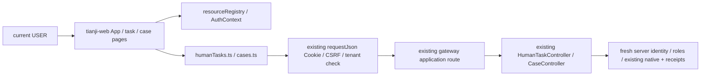
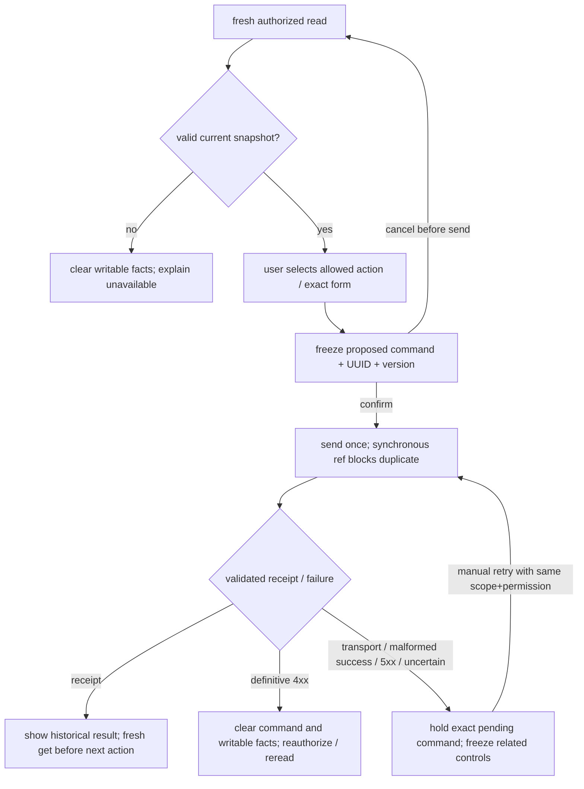

# 天机任务箱、案件与审批前端

| Field | Value |
| --- | --- |
| Document | `2026-11-04-22-56-task-case-approval-web.md` |
| Template Version | `9` |
| Archetype Cleanup | `Not applicable` |
| Status | `Review` |
| Type | `Feature` |
| Complexity | `Complex` |
| Complexity Drivers | current-user permissions/tenant affinity、schema form、opaque versions、unknown command outcome、PROCESS/CASE state races |
| Created | `2026-11-04 22:56 Asia/Shanghai` |
| Updated | `2026-11-04 23:26 Asia/Shanghai` |
| Owner | 原用户整体蓝图继续授权；Root 源码审阅；本文件尚未独立批准为 Accepted |
| Repository | `tianji-web` |
| Scope | 原蓝图 P1/T3-11：当前用户任务箱、人工任务/审批、Case ID 查询和有限 plan-item 动作 |
| Change Surface | 仅现有 React frontend 的 App routes、四个 permission entrypoints、新 task/case API decoder、三个页面、schema form、轻量 command-state reducer、相应测试/fixtures/README；官方重建本地PAC lock时仅contract.sha256更新 |
| Affected Chapters | `§7, §8, §10, §12, §13, §14, §15, §16, §17, §18` |
| Source Requirement | [整体蓝图](../../../../docs/plans/agent-framework-upgrade-plan.md) `T3-11 / S08 / S09`；原用户要求继续执行并保持聚焦提交 |
| Baseline Revision | `tianji-web main@14f89aaaedad21d650481f14e5496bbf5debfc68` clean；backend source `tianji-service main@cfffb7649af7a1cb429ac935f2bc2c1f88ac3d8d` |
| Amends | `None` |
| Supersedes | `None` |
| Depends On | [整体蓝图](../../../../docs/plans/agent-framework-upgrade-plan.md) `T3-11`；[正式 Case 服务端](../../../../tianji-service/docs/egon/spec/2026-11-04-15-50-formal-cmmn-case-server.md) `§7.3, §9, §10, §12`，以当前 C/CL/PS 源码实现的现有合同为准 |
| Related Specs | [Case Java 合同](../../../../tianji-service/docs/egon/spec/2026-11-01-23-20-case-client-contract.md), [Case HTTP SDK](../../../../tianji-service/docs/egon/spec/2026-11-01-23-45-case-http-client.md) |
| Related Plans | [Task/Case/Approval Web Plan](../plan/2026-11-04-23-14-task-case-approval-web.md) |

## 1. Summary

现有天机 Web 只有 Agent run 与 Memory 页面，人工任务及 Case 后端合同已有源码。本次只把现有 current-user 合同接入现有 Cookie/CSRF transport、resource registry 和 EnterpriseLayout，使用户能分页查看我的/候选/全部可见任务、认领/归还/转交已发布队列、按 schema 完成任务或明确批准/拒绝，并按已知 Case ID 查看当前事实和服务端允许的有限动作。

Case 当前没有 list/history API。本设计采用 Case ID 查询，时间线只呈现真实 submittedAt/finishedAt，以及明确标为“本次页面操作回执”的内存结果；不虚构完整历史。合同 Mock、组件和静态构建与真实 S08/S09、IAM、gateway、Flowable/PG 接受验收分别记录。本文为 Review，不表示用户已接受，不创建 Plan 或源码。

## 2. Background and Current State

### 2.1 Business and user context

人工参与者需要看到可处理任务、明确审批决定及冲突结果；Case 操作者需要理解当前 plan-item 状态。服务器独占 tenant、身份、角色、申请/审批分离、native lifecycle、版本与 receipt 的判定权。前端提供可理解的预防性限制，不授予权限。

### 2.2 Repository evidence

以下 frontend 路径相对 `tianji-web/`；C=`tianji-service/stellar-enclosure-tianji-contract/src/main/java/top/egon/cola/platform/tianji/contract/orchestration/`，CL=`tianji-service/stellar-enclosure-tianji-client/`，PS=`tianji-service/stellar-enclosure-tianji-process-server/src/main/java/top/egon/cola/platform/tianji/process/server/`。

| Evidence ID | Classification | Exact path/symbol/decision/command | Observed fact | Design significance | Verification limit/freshness |
| --- | --- | --- | --- | --- | --- |
| EVD-501 | Static repository | `src/App.tsx:SessionRoutes/RequireResource/Shell` | 现有 /runs、/memory、page guard、动态 navigation；首页仅二选一 | 扩展同一壳和 landing 顺序 | 当前 commit；未打开浏览器 |
| EVD-502 | Static repository | `src/auth/AuthContext.tsx:retry/allows`；`src/api/client.ts:requestJson`；`src/auth/gatewayAuth.ts` | identity/snapshot scope、requestEpoch、Cookie/CSRF、tenant mismatch fail closed | 新页面复用 transport，不改 auth | 未验证部署路由/IAM |
| EVD-503 | Static repository | `src/pages/MemoryPreferenceIntentStatus.tsx:IntentStatus/send` 及同名测试 | full identity key、abort、proposed/pending、未知结果冻结原命令、已知拒绝要求重读 | 复用交互和测试风格 | 测试源码，不是本次已执行结果 |
| EVD-504 | Static repository | C `HumanTaskClient`, `HumanTaskDTO`, `HumanTaskPageDTO`, commands/enums；CL `HumanTaskResponseCodec`, `HttpProcessClient:taskPage/taskAction` | 7 POST；scope PROCESS/CASE、kind ACTION/APPROVAL；opaque 64hex version；空页可继续 | 保持精确合同，不能用 task status 或数字 revision 替代 | 不是线上接口可用性证明 |
| EVD-505 | Static repository | C `CaseInstanceQuery/CaseInstanceDTO/CasePlanItemDTO/ActOnPlanItemCommand/CaseOperationResult`；CL `src/main/resources/META-INF/tianji/openapi/case-v1.json` | 固定 start/get/act；本次只消费 get/act；无 list/history；允许稀疏 terminal planItems | ID lookup、当前事实、有限动作 | OAS 文案仍包含 earlier consumer/provider caveat；以当前 PS routes 核对 |
| EVD-506 | Static repository | PS `api/HumanTaskController`, `api/CaseController`, `api/ProcessApiErrors`, `security/TianjiProcessPermissions` | 真实 route/resource/permission/status；默认 flags 控制；USER 写 task/plan | 不引入 BFF/API 或服务凭据 | 未执行 feature/IAM/native runtime |
| EVD-507 | Static repository | PS `task/HumanTaskAccessRules`, `HumanTaskActionResult`；`execution/ProcessValues` | 角色/申请者限制在后台；lane 非用户；schema exact keys；INTEGER ±999999999999999 | 不让浏览器模拟 roles、assignee 或批准凭证 | server source only |
| EVD-508 | Static repository | `package.json`, `vite.config.ts`, `scripts/build.mjs`, `permission-manifest.config.json`, `README.md` | React/AntD/SDK/Vitest；四个 permission entrypoints；专门 permission build | 不加依赖/构建步骤；保留唯一 build gate | Root本次核验Node24.14.1/SDK官方verify通过；artifact重打包SHA需更新本地lock |
| EVD-509 | Static repository | `src/pages/AgentRunsPage.tsx`, `src/styles.css`, `src/test/preferenceIntentFixtures.ts` | page-stack、page-heading、surface-card、Table/Form/Modal/Space 和 colocated tests | 精确延续现有 UI/样式 | 无 GUI 视觉验收 |
| EVD-510 | User decision / Static repository | 原任务继续授权；整体蓝图 T3-11 与最新 T3-08 progress | T3-08 源码交付，S09 Required/RuntimeUnverified；禁止自动启动和 GUI | 本次不能宣称完整 S08/S09 已通过 | 本次仅设计 |

### 2.3 Problem statement and gap

现有 permission app gate 只接受 Agent READ/Memory READ，因此 task-only/case-only identity 即使 backend 已授权也进不了壳。缺少 task/case consumer、routes、表单及防过期写保护；缺少 Case list/history 不通过扩大 backend scope 补造。

### 2.4 Evidence and current-chain map

| Entry/trigger | Current call chain | Data read/written | External dependency | Consumers | Evidence |
| --- | --- | --- | --- | --- | --- |
| Web session/route | AuthProvider→gateway identity/bootstrap→resourceRegistry→SessionRoutes | in-memory verified identity/snapshot | existing gateway/session/PDP | 现有 runs/memory | EVD-501/502 |
| Human task current-user operations | HumanTaskController→TianjiHumanTaskAccess→FlowableHumanTaskService→native task + receipt | native/released schema/receipt；前端未接 | PS/native/PG/IAM | C/CL existing consumers | EVD-504/506/507 |
| Case lookup/action | CaseController→TianjiCaseAccess→FlowableCaseService→native Case/history/provenance/receipt | server-owned current snapshot and immutable result | 同一 PS | C/CL existing consumers | EVD-505/506 |

### 2.5 Archetype example cleanup

Cleanup disposition: Not applicable

Reason: `tianji-web/package.json` 与 `src/App.tsx` 证明目标是既有 React Web consumer；本次不创建 Egon Maven business project、不触及 archetype examples 或 Java module，现有 runs/memory 是实有业务页面，不是待删示例。

## 3. Goals and Non-goals

### 3.1 Goals

在现有壳中闭合当前用户任务、schema form、Case snapshot/action、安全重试与可核验权限 manifest；保留 runs/memory 行为。

### 3.2 Non-goals

不修改 backend/C/CL/OAS、DB/Flyway、POM、package/package-lock/scripts、auth transport/config、全局样式或 SDK；不新建 BFF/query framework/provider/store/建模器；不提供 Case start/list/history、全案 terminate、plan COMPLETE、approval verify UI、service token。可选管理员 task query 不在当前页面范围：普通 ALL 仍只表示当前身份可见。真实部署、catalog registration/activation、role grants、runtime/browser 验收由单独环境执行。

### 3.3 Change Surface and Design Depth

| Area/layer | Disposition | Exact repository evidence | Changed or preserved behavior/contract | Required Spec treatment | Chapter(s) |
| --- | --- | --- | --- | --- | --- |
| Routes/navigation/permissions | Affected | `src/App.tsx`；`src/permissions/{permissions,resources,references,messages}.ts` | 新 routes、read-only identities landing、显式 read/write resources | exact keys/guards/fields/tests | §7, §8, §12, §14, §15, §16 |
| Frontend task/case API mirrors/decoders | Affected | existing `src/api/memoryPreferenceIntents.ts` precedent；C/CL authority | 新 TS consumer，wire 不变，closed validation 与 request affinity | models, failure rules, mapping/tests | §7, §8, §10, §14, §15, §16 |
| Task/Case page command/form state | Affected | EVD-503/509 | 三页、schema form、page-owned abort、shared pure State reducer | page detail + uncertainty + pattern | §7, §8, §10, §12, §13, §14, §15, §16, §17, §18 |
| Tests/fixtures/README | Affected | colocated Vitest/Testing Library；README validation | 合同/组件 Mock、source/acceptance limits | exact files/cases/gates | §8, §14, §16 |
| Backend REST/C/CL/OAS | Context-only | EVD-504/505/506 | Method/URL/body/status/resource/transaction 保持 | concise authorities/consumer constraints | §9 |
| Gateway/AuthContext | Unchanged | EVD-502 | issuer+tenant+subject+epoch、Cookie/CSRF、expiry fail closed | cite preserved invariant, regression | §15 |
| DB/migrations/native lifecycle | Unchanged | EVD-506/507 | 只通过现有 API 访问，数据库权威和迁移不变 | no ER/DDL design | §11 |
| 本地PAC artifact锁 | Affected | `permission-toolchain.local.lock.json`；Root官方工具验证 | 仅固定已验证重打包JAR的contract.sha256，其他字段保持 | exact artifact gate | §8, §14, §16 |
| Runs/Memory/style/build/dependencies | Unchanged | EVD-501/508/509 | 原页面/测试、CSS、PAC build 命令不改 | regression + diff boundary | §14, §16 |
| New Java scaffolding | Not applicable | TS-only target tree §8 | 无生成器/Java types/Bean 配置变更 | evidence-backed N/A | §8 |

## 4. Requirements and Acceptance Criteria

| ID | Atomic requirement | Priority | Observable acceptance criteria | Source |
| --- | --- | --- | --- | --- |
| REQ-501 | task/case read-only identity 可进入对应授权入口 | Must | app ANY 加 TASK_READ/CASE_READ；menu/page/button 各 gate；landing 不落无权限页面 | T3-11 + EVD-501 |
| REQ-502 | PROCESS/CASE 我的、候选、全部可见任务 cursor 分页 | Must | ASSIGNED/CANDIDATE/ALL；limit 1..50；空 items+非空 cursor 仍可继续；筛选变更 reset | T3-11 + C page/query |
| REQ-503 | 显示 task 当前事实并保护 claim/unclaim/transfer | Must | 根据 suspended/assigned/assignedToMe 和 resource；transfer 只从 availableLanes 选，server 最终判定 | T3-11 + EVD-507 |
| REQ-504 | schema 限制的 ACTION/APPROVAL form | Must | 仅 schema keys/type/bounds；批准与拒绝均显式选择；无额外 variables/actor；空 schema 发 {} | T3-11 + C/ProcessValues |
| REQ-505 | Case ID 查询和真实当前事实/时间线 | Must | 不调用虚构 list/history；显示 status/planItems、submitted/finished；稀疏终态正常 | T3-11 + EVD-505 |
| REQ-506 | Case plan-item 按服务器动作与资源交集操作 | Must | ACTIVE ∩ availableActions ∩ CASE_PLAN_ITEM_ACT；无 COMPLETE/全案 terminate；TERMINATE 有真义确认 | T3-11 + C action/result |
| REQ-507 | 写入冻结原命令并防重复/未知结果重试 | Must | 首次确认生成 UUID+expectedVersion/body；in-flight ref 防双击；未知仅手动重试同一命令，不生成新 UUID/自动 retry | T3-11 + EVD-503 |
| REQ-508 | 已知拒绝/过期状态清除旧可写事实 | Must | 400/401/403/404/409 等 definitive 4xx（明确排除408/429） 后 fresh read/reauthorize；404 不声称已完成；成功 receipt 后重读当前事实 | T3-11 |
| REQ-509 | full auth/resource affinity 与旧响应隔离 | Must | issuer/tenant/subject/requestEpoch+task/case/filter key 变化 abort/reset；晚响应无效，form/receipt/cursor 不串身份 | T3-11 + EVD-502/503 |
| REQ-510 | 精确测试与静态/运行验收分离 | Must | 合同 Mock/组件、typecheck/lint、专用 npm build；不绕过 PAC；S08/S09/浏览器未执行明确标明 | T3-11 + user rules |

### 4.1 Scenario matrix

| Scenario | Actor/trigger | Preconditions | Main path | Alternative/failure path | Data/state change | Observable result | Requirements |
| --- | --- | --- | --- | --- | --- | --- | --- |
| task browsing | 当前用户筛选 | TASK_READ、fresh session | POST query→下一 cursor | 空 items+cursor 保留 next；真末页无 next；error 清旧页 | local page only | 当前身份可见范围，非 admin all | REQ-501, REQ-502, REQ-509 |
| claim/unclaim/transfer | 当前用户确认 | fresh task + action permission | command→validated receipt→fresh get | another claimant/role change/timeout 走 conflict 或 unknown | backend owns atomic write | 结果事实与当前状态分开展示 | REQ-503, REQ-507, REQ-508 |
| approval | 受权审批者提交 | assignedToMe、not suspended、schema | 显式批准/拒绝→complete | invalid form no request；applicant/role denied 由 server；未知重试原 form | immutable command copy；server decision | false 也是有效明确决定；无默认批准 | REQ-504, REQ-507, REQ-508 |
| Case current facts | 用户输入 Case ID | CASE_READ | get→status/known instants/planItems | hidden/flag-off 404；terminal sparse/[] 接受 | local snapshot only | 不虚构历史或终态动作 | REQ-505, REQ-509 |
| Case action | 当前用户明确确认 | ACTIVE + server action + permission | frozen command→receipt→get | Case/PI变更409；TERMINATE assignee guard由server；response lostunknown | server-owned native state | 动作回执不冒充最新 snapshot | REQ-506, REQ-507, REQ-508 |
| identity switch/recovery | session invalidation、tenant/issuer/subject/epoch切换 | read/write underway | abort old controllers→new keyed frame | 旧 promise late resolve ignored；unknown write不声称撤回 | local state discarded；server结果未知 | 旧 scope 无 form/receipt/actions 残留 | REQ-509, REQ-510 |

### 4.2 Use-case analysis

| Actor ID | Actor/role | Goal and responsibility | Entry/channel | Permission/tenant context | Evidence |
| --- | --- | --- | --- | --- | --- |
| ACTOR-501 | current-user task participant | 查找和处理当前可见任务/审批 | inbox/detail | verified USER，TASK_*，server fresh membership | EVD-504/507 |
| ACTOR-502 | Case observer/operator | 已知 Case ID 查事实/执行获准动作 | case lookup/detail | CASE_READ；写需 CASE_PLAN_ITEM_ACT，server roles | EVD-505/506 |

| ID | Use case/goal | Primary actor | Supporting actors/systems | Trigger | Preconditions | Main success outcome | Alternatives/failures | Postconditions | Requirements | Interfaces/pages | Tests |
| --- | --- | --- | --- | --- | --- | --- | --- | --- | --- | --- | --- |
| UC-501 | 找到待办与候选任务 | ACTOR-501 | PS/gateway | 打开任务箱或切换筛选 | authenticated TASK_READ | 分页显示当前可见任务并进入详情 | empty-continuation、denial、network、scope switch | read only；无旧页串 scope | REQ-501, REQ-502, REQ-509, REQ-510 | TaskInboxPage、human-tasks/query | TEST-501, TEST-503, TEST-507 |
| UC-502 | 领取/归还/转交并完成任务或审批 | ACTOR-501 | PS fresh roles/native receipt | detail confirm | readable fresh task、对应permission、schema有效 | matching receipt，成功后重查；审批明确 true/false | conflict/unavailable、self-approval rejection、lost response 原命令retry | authoritative mutation once or explicit unknown；旧facts不可再写 | REQ-503, REQ-504, REQ-507, REQ-508, REQ-509 | TaskDetailPage、existing task commands | TEST-501, TEST-502, TEST-504, TEST-507 |
| UC-503 | 查 Case 并执行允许的计划项动作 | ACTOR-502 | PS Case/native/history | ID lookup/confirm action | CASE_READ，写需server action+resource | 当前事实、真实 instants、本页 receipts；finite action then fresh get | 404不可见/入口未启用、409 stale、unknown frozen、terminal sparse | 无虚构history；receipt不当作当前facts | REQ-505, REQ-506, REQ-507, REQ-508, REQ-509, REQ-510 | CaseDetailPage、cases/get/act-plan-item | TEST-502, TEST-505, TEST-506, TEST-507 |

## 5. Constraints, Assumptions, and Decisions

### 5.1 Confirmed constraints

仅 tianji-web；继承用户 AGENTS 规则。不运行 browser/GUI/server/DB，不改变 backend/DB/dependencies/auth/build工具；本地permission lock仅允许下述artifact SHA更新，不登记或授予权限。方法名/路径中的 legacy POST Query 保持。所有状态判断只来自本次当前响应；UI permission snapshot 不替代 server authority。

### 5.2 Small-gap assumptions

| ID | Inference | Repository evidence | Why locally reversible | Impact if wrong |
| --- | --- | --- | --- | --- |
| ASM-501 | /tasks、/tasks/:taskId、/cases、/cases/:caseInstanceId 延续当前 route pattern | App /runs + /runs/:runId | 新路径尚无消费者，局部路由/文案 | review 时调整路径与manifest/test |
| ASM-502 | 默认 scope PROCESS、selection ASSIGNED、limit20；Case ID手输或已授权 task CASE link | C query允许；当前无Case目录 | 纯 page initial values，不改变wire | 调整默认值，无migration |
| ASM-503 | 新时间显示统一标注 UTC，并保留原wire值在time属性/详情 | 当前无统一 time preference；C Instant | 新页面局部显示决定 | 如需用户zone，另行选择显式zone；不改数据 |

### 5.3 Resolved decisions

| ID | Decision | Decision owner | Evidence and rationale | Requirements |
| --- | --- | --- | --- | --- |
| DEC-501 | 无Case list/history时限于ID查询/当前事实，不能补造API或全历史 | 既定backend合同/原scope | EVD-505；完整历史需要后续backend任务 | REQ-505 |
| DEC-502 | ordinary ALL非管理员；admin/query UI本次不引入 | 最小范围设计，待Root审阅 | /admin/query需TASK_READ+TASK_TRANSFER且其结果可能不可ordinary/get；避免假admin详情 | REQ-502, REQ-503 |
| DEC-503 | unknown write沿用proposed/pending风格，纯State reducer复用两页协议 | repository-consistent design | EVD-503；不需要全局provider/query cache | REQ-507, REQ-509 |

### 5.4 Open major decisions

无待决业务/协议扩展。未做真实环境验收是明确验证边界，不是默认验收。Review 等待 Root/用户审阅，不把延续任务授权改写为独立 Accepted。

## 6. Project Technology Context

React19.2、TypeScript6、AntD6、React Router7、Vite8、Vitest4、Testing Library/jsdom，精确版本以 `package-lock.json` 为准。已存在 tanstack dependency，但页面主流以本地useState/useEffect/ref/AbortController实现，本次不激活新的query基础设施。permission-manifest.config声明四个entrypoints；registry.ts原样消费resources/references。

### 6.1 Java architecture profile and capability baseline

本次无 Java code。保留现有 `src/api`→`src/pages`→`src/App.tsx` 与 `src/auth`/`src/permissions`，不创造Java传统层/COLA hybrid。backend Java既有结构只作为未改动authority，不能强行将Lombok/Spring rules映射到TS。

| Need | Existing capability | Proven gap | Decision/dependency impact |
| --- | --- | --- | --- |
| HTTP/session/CSRF/tenant | requestJson / gatewayAuth / AuthContext | task/case typed consumer缺失 | 新API文件只调用现有requestJson；无依赖 |
| UI/layout/permission/i18n | EnterpriseLayout、AntD、resourceRegistry、defineMessages | 新route/owned资源缺失 | 原四entrypoints扩展；样式不改 |
| unknown command lifecycle | MemoryPreferenceIntentStatus proposed/pending precedent | 两页共享同一协议易分歧 | 纯State reducer一文件；无provider/manager |
| task form primitive types | AntD Form/Input/Select、TextEncoder/native number | 动态schema component缺失 | 小型表单组件；不接任意JSONSchema引擎 |

### 6.2 User-mandated Java rule compliance

下表按原编号逐条保留适用性；Rule11始终检查结构/复用边界。Java限定要求不盲目套到TypeScript，当前backend Java未变。

| Literal rule | Affected? | Repository evidence | Exact design decision | Files/types/interfaces | Validation/test evidence | Status/blocker |
| --- | --- | --- | --- | --- | --- | --- |
| Rule 1 | No | §8目标全.ts/.tsx/.md | 无新增Java命名；TS类型用语义名称 | API TS mirrors | file inventory review | N/A |
| Rule 2 | No | 无Java handoff/Bean Validation变化 | Java注解不适用于TS；UI校验见§10/12 | TaskSchemaForm/API decoder | TEST-501/504 | N/A |
| Rule 3 | No | 无Java POJO/converter变化 | 不引入Lombok/record/MapStruct映射 | readonly TS types | targettree review | N/A |
| Rule 4 | No | 无Spring business Bean变化 | 不引入Java日志/DI | §8全部目标 | diff boundary | N/A |
| Rule 5 | No | 无Java utilities/dependency变化 | 使用现有TS/DOM原生能力 | API/pages | package/lock unchanged | N/A |
| Rule 6 | No | 不修改Spring/Jackson合同 | 浏览器JSON保持原wire；无Java serializer变化 | C/CL unchanged | TS fixture parity TEST-501/502 | N/A |
| Rule 7 | No | 无Spring profile/config变化 | 既有keys/flags原样 | env/auth/backend unchanged | diff boundary | N/A |
| Rule 9 | Yes | unknown retry lifecycle属于复杂控制状态 | State pattern，纯reducer+page-owned effects，非硬编码分散状态 | pages/orchestrationAction.ts | TEST-508 | PASS |
| Rule 10 | No | 无Java time字段变化 | TS string只显示；具体UTC策略§6.3 | task/case time fields | TEST-506 | N/A |
| Rule 11 | Yes | App/API/pages/permissions现有结构；backend C/CL/PS界限 | 保留既有frontend与未改Java结构，复用SDK；不引入第三层/持久化/Event | exact §8 tree | static diff + TEST-507 | PASS |

### 6.3 Time semantics and conversion contract

Time contract: Required

| Time ID | Fields/symbols | Semantics | Java/runtime type | Storage policy | Wire policy | Business zone source | Display zone source | Boundary / DST rules | Precision / Clock | Compatibility | Verification |
| --- | --- | --- | --- | --- | --- | --- | --- | --- | --- | --- | --- |
| TIME-501 | HumanTask.createdAt/dueAt、HumanTaskActionReceipt.occurredAt、Case.submittedAt/finishedAt、CaseOperationResult.occurredAt | Occurred instant | TS readonly string；server existing Instant | Not persisted | UTC Z | Not applicable: no calendar/business-time computation | 明确UTC；标签UTC，Intl.DateTimeFormat显式timeZone UTC，原字符串保留 | 只接受有Z/offset的ISO instant；offset兼容既有C/CL；无local输入，null不猜测；不做DST业务计算 | 原wire纳秒保留；展示Date最多毫秒且不回传，不用Date作为version/order authority；无新clock | 现有C/CL接受offset/纳秒；server wire保持，不改DB；UTC展示不加减固定小时；不新增chronology约束 | TEST-506 在UTC/Shanghai/NewYork输入同instant；raw精度不变 |

## 7. Architecture Design

### 7.0 Minimum-design baseline and element-necessity audit

| Proposed element | Change | Requirements | Existing/direct alternative | Concrete inadequacy of alternative | Added calls/state/coupling/failures/migration/operations | Verdict |
| --- | --- | --- | --- | --- | --- | --- |
| requestJson/AuthContext/SDK layout | Keep | REQ-501, REQ-509 | direct existing reuse | 无缺口 | 原session/transport契约 | Keep |
| humanTasks.ts / cases.ts readonly types+decoders | New | REQ-502..REQ-508 | raw unvalidated requestJson<DTO> | TS断言无法拒绝foreign/coerced/mismatched响应 | 当前existing API调用与decoder errors；无server新增 | Add |
| TaskInboxPage/TaskDetailPage/CaseDetailPage | New | REQ-501..REQ-506 | runs/memory组件 | 现有组件语义不同，不能承载task/case | local read/form/cursor/receipt states | Add |
| TaskSchemaForm | New | REQ-504 | detail内嵌全部类型render/validation | 页面同时负责command状态；独立form便于exact primitive边界测试 | 一个受控组件；无通用schema引擎 | Add |
| orchestrationAction.ts pure reducer | New | REQ-507, REQ-509 | 两页面各自多布尔状态 | 容易出现unknown解冻/新UUID语义分歧 | 小型typed State，page effects不转移 | Add |
| frontend resource entries | Expand | REQ-501, REQ-503, REQ-506 | 原registry gate | 原console只认Agent/Memory READ | build manifest增量；不自动激活 | Add |
| Case list/history/start/admin-task console/BFF/cache/provider/new dependency | Remove | REQ-505, REQ-510 | IDlookup/existing APIs/page state | 本次无独立新增合同授权/需求；不可凭空推断 | 避免新的兼容/identity/persistence面 | Remove |

| Path | Network calls | Client states | Server contracts/state | Failure and TOCTOU points | Additional user/business value |
| --- | --- | --- | --- | --- | --- |
| Direct baseline | inbox每页1query；detail1get；action1POST后1get | read/form/write/unknown | existing APIs/receipts | read到write可竞态，expectedVersion+server权限解决 | 完成当前要求 |
| Selected design | 同baseline；未知仅用户每点击一次重发原POST，不自动循环 | explicit State防矛盾组合 | 无新增 | 成功receipt与freshget分开；freshget失败禁写 | exact decoder / frozen command增加正确性，零预检API |

### 7.1 System Architecture Design



| Fact/decision | Authoritative owner | Readers/copies | Write entry | Consistency model | Conflict rule | Recovery owner |
| --- | --- | --- | --- | --- | --- | --- |
| identity/roles/permissions | gateway/IAM + server current checks | verified AuthContext snapshot | existing session/authorization | snapshot UI hint + fresh server authority | epoch/expiry fail closed | existing auth retry |
| task/Case current state/version/actions/schema | PS native/released facts | page readonly snapshot | existing commands | server transaction/opaque version fence | 409/404→fresh query | server + user fresh read |
| operation result | server immutable receipt | page receipt, command frozen copy | same original command | replay reference≠current state | same UUID/body expectedVersion | user manual retry |
| form/cursor/proposed/pending | keyed page frame | none shared globally | local UI | in-memory only | no cross-resource reuse | reset/abort on scope change |

### 7.2 High-Level Design



#### 7.2.2 High-level decision and quality matrix

| Concern/use case | Required behavior/SLO | Current evidence | Design mechanism | Failure/degradation behavior | Verification |
| --- | --- | --- | --- | --- | --- |
| tenant/security UC-501..503 | no cross-frame data/actions | EVD-502/503 | full identity/resource key + abort + local sequence | old responses ignored, auth invalidates | TEST-507 |
| correctness UC-502/503 | no implicit approval or fresh UUID retry | EVD-503/507 | exact schema + State snapshots + one write ref | unknown freezes edits/read refresh | TEST-504/508 |
| availability UC-501/503 | actionable honest empty/unavailable | C page/Case DTO | continuation remains；no invented terminal status/history | retry reads manually；no automatic polling | TEST-503/505 |
| maintainability/build | existing dependencies/layout/PAC gates | EVD-508/509 | local TS components, unchanged scripts | missing toolchain reported, not bypassed | TEST-510 |

### 7.3 Detailed Design

#### 7.3.1 Detailed component collaboration

页面wrapper用 `JSON.stringify([identity.issuer,identity.tenantId,identity.subject,binding.requestEpoch,resourceKey,...route/filter])` 作为key；task detail加入taskId，Case加入caseInstanceId，inbox加入scope/selection/filter值。对所有read/write创建page-owned AbortController；cleanup abort。并用本地read sequence/current-controller检查避免同frame旧刷新覆盖新读取。状态只用readonly DTO，不把URL中的tenant或角色当授权。

`orchestrationAction.ts` 导出泛型 `OrchestrationActionState<ReadonlyCommand>` 与纯reducer；state为 idle / proposed(command) / submitting(command) / unknown(command)。事件 propose、cancelProposal、send、uncertain、settled、reset，非法事件保留当前state。propose只来自validated snapshot与随机UUID；send不允许改变command；unknown只接受send原command。类型中command是只读深复制，form扁平primitive可冻结；不用全局map/store/provider。page refs同步锁定send，effect负责HTTP、copy、fresh-read。该模块不生成UUID、不访问网络、不解释业务roles。

#### 7.3.2 Critical-path Mermaid swimlane

```mermaid
sequenceDiagram
  actor User
  participant Page as TaskDetail / CaseDetail
  participant State as pure action State
  participant API as existing requestJson + typed decoder
  participant PS as existing Process Server
  User->>Page: read / choose / confirm
  Page->>State: propose frozen command (UUID, version, body)
  Page->>API: one POST under captured scope
  API->>PS: Cookie/CSRF + tenant-check header, original body
  alt committed receipt returned and validated
    PS-->>API: matching immutable receipt
    API-->>Page: receipt
    Page->>State: settled
    Page->>API: fresh get; old writable facts already cleared
  else known authorization / validation / stale conflict
    PS-->>Page: definitive 4xx via ApiError
    Page->>State: settled; require fresh read / auth
  else response lost / unvalidated success / server failure
    API-->>Page: uncertain failure
    Page->>State: unknown(original command)
    User->>Page: manual retry original request
    Page->>API: exact same command, no automatic retry
  end
```

#### 7.3.3 Transactions, consistency, concurrency, and idempotency

Frontend无事务/persistence；PS事务/receipt不变。每次写从当前DTO的 `version` 原字符串复制为 `expectedVersion`，不是expectedRevision/number。确认时捕获schema/form/lane/action/resource身份及UUID。只有首次proposal生成一次crypto.randomUUID；无安全UUID时本地失败零请求。unknown/in-flight冻结同页form、lane、action、CaseID/scope、查询/刷新以及同页相关链接；按钮只保留原请求手动重试且重新检查当前permission。普通new-command入口不能覆盖pending。浏览器硬导航/unmount只会abort客户端，不能承诺撤回server已处理请求；本地pending不持久化、不自动恢复/重发。再次进入必须fresh read，server版本/receipt仍为最终防重权威。

#### 7.3.4 Failure semantics, recovery, and reconciliation

| Failure point | Detection | Immediate behavior | Data state | Retry/idempotency | User-visible result | Reconciliation |
| --- | --- | --- | --- | --- | --- | --- |
| invalid local input | TS/form validator before transport | keep form error；no request/UUID发送 | server untouched | correct input, new proposal | field-specific safe message | local user |
| read fail/404 | ApiError/decoder | clear old snapshot/action eligibility | unknown visibility/current state | manual read；401/403 existing auth behavior | “当前不可见、已变化或入口尚未启用”，不称已完成 | fresh auth/read |
| definitive write rejection | positive HTTP4xx excluding 408/429；400/401/403/404/409 remain definitive | clear proposed/pending + loaded/form；disable writes until fresh read | not infer successful result | no direct oldcommand retry；reauthorize/reread/review | 409变化冲突、404不可用、403权限变化 | existing server + user |
| unknown write outcome | network/timeout/abort while frame alive、malformed/foreign success、408、429、5xx | retain command；freeze related UI；do not apply guessed state | server may have committed | manual samecommand once per click；no auto/backoff/newUUID | “结果暂时未知，请重试原请求；离开不代表撤回” | validated replay then fresh read |
| success then fresh read fails | matching receipt + read failure | receipt retained as historical；loaded remains empty | receipt factual, current state unknown | only refresh current state, never resend successful action | “操作已接受，当前状态暂不可用” | manual fresh get |
| auth/resource/route key changes | keyed remount/permission guard/epoch | abort/discard local sensitive state | oldserver write may have happened | no oldcommand replay under newidentity | new frame no prior result | later currentauthorized read |

不展示raw response/error body、internal role hashes、approval grant、stack、service credentials。safe固定文案；401/403/tenant409交还既有AuthContext处理。

#### 7.3.5 Observability and operational boundaries

无新日志/telemetry或自动polling。UI只显示业务引用、UTC事实时间和明确来源的结果；不把业务form写console/localStorage。README记录feature/gateway/IAM前置与未知结果说明；保留server既有audit owner。runtime定位使用现有commandId/reference，不以UI成功提示证明流程已推进。

#### 7.3.6 Conclusion evidence chain

| Conclusion | Evidence | Constraint/requirement | Decision | Consequence/trade-off | Verification |
| --- | --- | --- | --- | --- | --- |
| 简单page-state足够，复杂控制用小State协议 | EVD-503 | REQ-507/509 exact retry & isolation | 两页面共享纯reducer，effects留页面 | 多一个小模块，避免provider/cache状态 | TEST-508/507 |
| Case只查已知ID并呈现真实有限事实 | EVD-505 | REQ-505，无list/history授权 | lookup/current snapshot +本页receipt | 不提供完整audit browsing | TEST-505/506 |
| transfer只选队列，approval明确决定 | EVD-504/507 | REQ-503/504，server roles权威 | availableLanes Select +无默认BOOLEAN | frontend不解释actor/role资格 | TEST-501/504 |

## 8. Package Structure and Code File Tree

所有下列路径相对 `tianji-web/`，Create/Modify为未来实现范围，不代表本文已修改。文件之外不做cleanup。

| Operation | Exact path(s) | Symbols/responsibility | Requirements |
| --- | --- | --- | --- |
| Modify | `src/App.tsx` | SessionRoutes、RequireResource、Shell；4新路径、菜单、ordered landing | REQ-501 |
| Modify | `src/permissions/permissions.ts` | TASK_READ/CLAIM/COMPLETE/TRANSFER、CASE_READ/PLAN_ITEM_ACT refs | REQ-501, REQ-503, REQ-506 |
| Modify | `src/permissions/resources.ts` | app ANY与owned page/menu/button资源 | REQ-501, REQ-503, REQ-506 |
| Modify | `src/permissions/references.ts` | six HumanTask + two Case exact API key CALLS references | REQ-502..REQ-506 |
| Modify | `src/permissions/messages.ts` | 同pageCode、zh-CN默认+en-US资源标签 | REQ-501 |
| Create | `src/api/humanTasks.ts`, `src/api/humanTasks.test.ts` | readonly mirrors、query/get/claim/unclaim/transfer/complete、strict decoder/request affinity | REQ-502..REQ-504, REQ-507..REQ-509 |
| Create | `src/api/cases.ts`, `src/api/cases.test.ts` | get/actPlanItem、strict mirror/transition/affinity | REQ-505..REQ-509 |
| Create | `src/pages/TaskInboxPage.tsx`, `src/pages/TaskInboxPage.test.tsx` | scope/filter/cursor、table、task/case links | REQ-502, REQ-509 |
| Create | `src/pages/TaskDetailPage.tsx`, `src/pages/TaskDetailPage.test.tsx` | task facts、actions、command/reload/receipt | REQ-503, REQ-504, REQ-507..REQ-509 |
| Create | `src/pages/TaskSchemaForm.tsx`, `src/pages/TaskSchemaForm.test.tsx` | controlled schema-only primitive values、explicit approval choice | REQ-504 |
| Create | `src/pages/CaseDetailPage.tsx`, `src/pages/CaseDetailPage.test.tsx` | optionalroute IDlookup、snapshot、facts timeline、PI actions | REQ-505..REQ-509 |
| Create | `src/pages/orchestrationAction.ts`, `src/pages/orchestrationAction.test.ts` | pure typed State reducer | REQ-507, REQ-509 |
| Create | `src/test/humanTaskFixtures.ts`, `src/test/caseFixtures.ts` | golden current C/CL wire mirrors、negative variants | REQ-510 |
| Create | `src/App.test.tsx` | mockedauth routes/nav/permission/landing boundaries | REQ-501, REQ-509 |
| Modify | `README.md` | newcapability/contract limits、same validation commands、no-runtime statement | REQ-510 |
| Modify | `permission-toolchain.local.lock.json` | 通过既有官方createToolchainLock重建；严格仅contract.sha256变化，五canonicalentries/sdk/mode/node不变 | REQ-510 |

文件树保持 `src/api`、`src/pages`、`src/test`，不新增architectural层；registry.ts/styles.css/现有业务文件不变。正式Spec落地路径为 `docs/egon/spec/2026-11-04-22-56-task-case-approval-web.md`。

## 9. Interface Definitions

Scope disposition: Context-only。无新增/改动外部或内部service合同，不为已有HTTP路由制造新的API编号/OpenAPI注解。新TS调用本身不是backend API变更。以下保留精确既有operations；请求/结果在§10仅定义browser mirror/校验，authorities不变。

| Existing operation | Authority/symbol | Consumer/preserved invariant |
| --- | --- | --- |
| POST `/api/tianji/v1/human-tasks/query` | C ListHumanTasksQuery / HumanTaskPageDTO；PS HumanTaskController.query | inbox；Query via legacyPOST；server current-user visibility；TASK_READ |
| POST `/api/tianji/v1/human-tasks/get` | GetHumanTaskQuery / HumanTaskDTO；Controller.get | taskdetail；IDaffinity；TASK_READ；无terminal-status |
| POST `/api/tianji/v1/human-tasks/claim` | ClaimHumanTaskCommand；Controller.claim | currenttask；TASK_CLAIM |
| POST `/api/tianji/v1/human-tasks/unclaim` | UnclaimHumanTaskCommand；Controller.unclaim | currenttask；TASK_CLAIM |
| POST `/api/tianji/v1/human-tasks/transfer` | TransferHumanTaskCommand；Controller.transfer | release-approved targetLane；TASK_TRANSFER |
| POST `/api/tianji/v1/human-tasks/complete` | CompleteHumanTaskCommand；Controller.complete | exactform；TASK_COMPLETE；server role/applicant constraints |
| POST `/api/tianji/v1/human-tasks/admin/query` | Controller.adminQuery；READ+TRANSFER资源/scopes | 本次不消费、不加reference；ordinary ALL不升级此入口 |
| POST `/api/tianji/v1/cases/get` | CaseInstanceQuery；CaseController.get；OAS case-v1.json | caseIDlookup；CASE_READ |
| POST `/api/tianji/v1/cases/act-plan-item` | ActOnPlanItemCommand；CaseController.actOnPlanItem；OAS | finiteUSERcommand；CASE_PLAN_ITEM_ACT |

每个调用通过requestJson发送既有gatewayrelative path、JSON、tenant-check header、Cookie/CSRF和AbortSignal；body不含tenant/issuer/subject/roles。response200/no-store与error `{code,correlationId}` authority为PS。backendOAS/annotations/security scopes不重写；consumer不得从OAS的bearerAuth自行创建浏览器Bearer token。Task/Case的服务flags或gatewayroute未配置时显示真实不可用。已知400/401/403/404/409/413/422与可能429/5xx处理按§7.3；408/429明确走unknown而非definitive；Case特有code/status配对以现有OAS为fixture来源，不能吞401/403假成功。

## 10. POJO and Data Model Design

本章只设计新的readonly TS mirrors/validator，不新增Java carrier/mapper。query/get函数接受tenant、typed query、可选AbortSignal；mutation函数必须另收完整readonly source snapshot作为仅本地关联校验参数（不进body），顺序为(tenant,command,source,signal?)。HumanTask mutation source是HumanTask，Case act source是CaseInstance；先完整校验source shape与command id/version/eligibility，再transport；运行期请求先校验unknown input，响应按closedrecord校验，拒绝数组冒充object、extra fields、coercion、未知enum、缺失mandatory fields、畸形Unicode。标准Object.keys/entries或null-prototype构建form，不能依赖不可信对象的prototype方法。不会发出任意JSON variables。

| TS mirror/field group | Exact fields/types/null semantics | Validation/mapping |
| --- | --- | --- |
| HumanTaskQuery | scopeType PROCESS/CASE；selection CANDIDATE/ASSIGNED/ALL；releaseVersion/scopeId/taskDefinitionKey/afterTaskId string\|null；limit number | 1..50 integer；id1..255，Java isBlank/ASCII trim等价判定，拒绝控制/NUL/unpaired surrogate；release `[A-Za-z0-9][A-Za-z0-9_.-]{0,127}`；definition/lane `[A-Za-z_][A-Za-z0-9_.-]{0,127}`；optionalfilters明确null |
| HumanTask | taskId,scopeType,scopeId,releaseVersion,definitionKey,taskDefinitionKey,name,kind,approvalField,version,lane,availableLanes,assigned,assignedToMe,suspended,formSchema,createdAt,dueAt | 同C DTO；name1..512；hash64lowerhex；lanes1..8 unique且含lane；assignedToMe⇒assigned；schema≤16；ACTION approvalFieldnull，APPROVAL field存在且BOOLEAN；nullableapprovalField/dueAt兼容CL的missing/null并normalize为null；所有boolean真boolean |
| HumanTaskPage | scopeType,selection,items≤50,nextAfterTaskId string\|null | matchqueryscope/selection/filters/limit；IDs unique、UTF8unsigned排序严格递增且大于after；next不倒退且≥last；ASSIGNED项assignedToMe，CANDIDATE项!assigned；empty+next合法；next字段必须存在 |
| Task commands | claim/unclaim `{commandId,taskId,expectedVersion}`；transfer再加targetLane；complete再加form | UUID由UI生成满足C command语法；expectedVersion=DTO.version；targetLane仅loaded.availableLanes；completeform exact keys≤16，无额外身份/source字段 |
| HumanTaskReceipt | commandId,taskId,action(CLAIM/UNCLAIM/TRANSFER/COMPLETE),scopeType,scopeId,releaseVersion,definitionKey,taskDefinitionKey,kind,lane,previousVersion,resultingVersion,approvalReceiptId,approved,occurredAt | matchcommandid/task/action/previousVersion；matchcapturedscope/release/definition/taskkind；transferlane=targetLane，否则原lane；COMPLETE resultingVersionnull，否则64hex且不同；APPROVAL COMPLETE才有非空approvalReceiptId+booleanapproved，且approved=sent form[approvalField]；CL允许nullablemissingnormalize；receipt是历史，不作为freshDTO |
| CaseQuery | `{caseInstanceId}` | id1..255；match returnedcaseID |
| CaseInstance | caseInstanceId,definitionKey,releaseVersion,businessKey,correlationId,status(ACTIVE/COMPLETED/TERMINATED),submittedAt,finishedAt,planItems | 所有field必须存在；ACTIVE⇔finishedAtnull；planItems≤16、instanceID和definitionKey各unique；terminal availableActions全空；无额外时间先后/必有planItem约束 |
| CasePlanItem | planItemInstanceId,planItemDefinitionKey,kind(HUMAN_TASK/MILESTONE),state(AVAILABLE/ENABLED/DISABLED/ACTIVE/COMPLETED/TERMINATED),version,availableActions | version64hex；actionsunique≤4；ENABLED允许DISABLE/START子集，DISABLED允许ENABLE子集，ACTIVE允许TERMINATE子集，其他空；MILESTONE空；不得从state补全缺失动作 |
| CaseActionCommand | `{commandId,caseInstanceId,planItemInstanceId,expectedVersion,action}` | exactfields；enum四项；version取选定PI；从currentCase snapshot捕获source元数据仅供关联，不放body |
| CaseOperationResult | commandId,caseInstanceId,planItemInstanceId,planItemDefinitionKey,action,releaseVersion,definitionKey,previousState,previousVersion,resultingState,resultingVersion,occurredAt | 全12字段必须存在；IDs/action/previousVersion matchcommand；sourcemetadata matchcapturedsnapshot；两hash不同；合法转换仅ENABLED→DISABLED、DISABLED→ENABLED、ENABLED→ACTIVE、ACTIVE→TERMINATED；不得拿result替换当前Case |

ID校验须逐项对应Java `String.isBlank()`与`String.trim()`（仅边界≤U+0020），不用JS `String.trim()`/`\s`替代；例如末尾NBSP/BOM在Java合同中合法时必须保留接受，UTF16长度和well-formed Unicode边界仍严格检查。用户输入只可做相同ASCII边界处理，不能静默改写合法Unicode ID。

`formSchema` key遵循C variable `[A-Za-z_][A-Za-z0-9_]{0,63}`及C OrchestrationChecks.RESERVED闭合集。STRING允许空串、≤1024 UTF16 units且≤4096 UTF8bytes，无NUL/unpaired surrogate；INTEGER是真JSON number、safeinteger、±999999999999999，UI只解析有效有符号十进制整数，不接受小数/exponent/NaN/Infinity或把字符串传server；BOOLEAN必须显式true/false。所有schema keys都提交一次，空schema提交{}，无null/undefined/default approval。服务端task schema可为空；当前CASE ACTION空form事实不是前端丢弃将来合法字段的理由。

Case时间遵循原C/CL，不增加chronology或millisecond精度约束；time解析只用于显示，保留原wire string。两consumer均一次派发不自动retry；transport错误与decoder失败抛safeerror，由page决定unknown语义。Java codec的raw duplicate-key/trailing-token检测不由普通浏览器JSON.parse保证，不伪称达到byte-level相同；本次测试保证已解析value的结构/关联约束，HTTP安全边界仍归既有transport/provider。

## 11. Database Design

Scope disposition: Unchanged。PS已有native/receipt/provenance/Inbox和现有Flyway history归backend；新Web只发既有API，无DB连接/SQL/schema/transaction改动，不新增migration、不编辑旧SQL、不画未变ER模型。静态diff必须保持整个tianji-service与Web环境配置未变。

## 12. Frontend Page Design

### 12.1 Route, navigation, permission, and page ownership

| Route/resource | Requirement | Navigation/ownership |
| --- | --- | --- |
| `/tasks` / `tianji.page.taskInbox` | ALL TASK_READ | menu `tianji.menu.tasks`，任务箱；TaskInboxPage |
| `/tasks/:taskId` / `tianji.page.taskDetail` | ALL TASK_READ | inbox link；TaskDetailPage |
| `/cases` / `tianji.page.cases` | ALL CASE_READ | menu `tianji.menu.cases`，案件查询；CaseDetailPage无routeID时仅lookup |
| `/cases/:caseInstanceId` / `tianji.page.caseDetail` | ALL CASE_READ | lookup成功navigation、CASEtasklink；sameCaseDetailPage |
| `tianji.button.taskDetail.claim` / `.unclaim` | ALL TASK_READ,TASK_CLAIM | target TaskDetailPage action claim/unclaim |
| `tianji.button.taskDetail.transfer` | ALL TASK_READ,TASK_TRANSFER | target TaskDetailPage action transfer |
| `tianji.button.taskDetail.complete` | ALL TASK_READ,TASK_COMPLETE | target TaskDetailPage action complete |
| `tianji.button.caseDetail.actPlanItem` | ALL CASE_READ,CASE_PLAN_ITEM_ACT | target CaseDetailPage action actPlanItem |

APP `tianji.app.console` ANY原READ/MEMORY_READ加TASK_READ/CASE_READ；保留原runs/memory菜单及relative route pattern，所有新页面RequireResource独立guard。landing顺序为首个允许page：runs→memory→tasks→cases；不存在可达page时403，不跳无权page。写资源不扩大read入口。所有新permission constants值分别为既有TIANJI_TASK_*、TIANJI_CASE_READ、TIANJI_CASE_PLAN_ITEM_ACT；所有messages使用现有defineMessages/pageCode/zh-CN+en-US风格。

references增加exact CALLS：`tianji.api.process.task.{query,get,claim,unclaim,transfer,complete}` 与 `tianji.api.process.case.{get,actPlanItem}`，不增加ownedAPI资源，不引用approval.verify、case.start或adminQuery。registry.ts和manifest.config的四entrypoints保持原样。

### 12.2 Layout and component tree

沿用page-stack/page-heading/surface-card/full-width；Typography.Title+说明、Space按钮、Card、Alert、Table、Tag、Form/Input/Select、Modal；不自造visual system或CSS。Inbox列name/kind/scope/lane/assignment/suspended/createdAt/dueAt/detail；scopeID/release为plain text。TaskDetail显示name/类型/scope/release/taskdefinition/queue/assignment/suspension与TaskSchemaForm+动作确认+receipt。CaseDetail显示lookup、status/definition/release/businessKey/correlationId、planItems Table、事实Timeline与本页操作receipt区域。

Task IDs/versions不解释为时间/序号；version只用于command不渲染内部hash。单纯PROCESS scopeID不是Agent runId，不链接/runs；CASE scopeID仅在CASE_READ且相应pageguard允许时链接/cases/id。原始内容始终普通React text，不dangerouslySetInnerHTML。

### 12.3 User flows, forms, and validation

Inbox选择scope PROCESS/CASE、selection ASSIGNED(我的)/CANDIDATE(候选)/ALL(全部可见)，可选releaseVersion/scopeId/taskDefinitionKey与limit；filtersubmit或scope/selection变更清page/cursor并从null cursor读。页表pagination=false，上一页使用当前frame cursor stack，下一页取server nextAfterTaskId；非空cursor即使items为空仍显示“后续可能还有可见任务，继续查询”，next有效。manual刷新重置第一页；不自动吞空页循环请求。

Detail进入/刷新get。claim仅!assigned&&!suspended+claimresource；unclaim仅assignedToMe&&!suspended+unclaimresource；complete仅assignedToMe&&!suspended+completeresource；transfer仅!suspended+transferresource且可选releaseapprovedlane。权限不足隐藏按钮；状态不满足显示已知原因。Form在新task/version/schema到来时reset；approvalField用明确“批准/拒绝”选择，无初始决定；其他BOOLEAN用是/否无默认；STRING/INTEGER按§10边界。完成先验证并生成proposed snapshot，再Modal确认决定/后果；claim/unclaim/transfer同一确认模式。服务器可能仍以role/applicant/assignee变化拒绝，文案说明“实际资格由服务器核对，申请人与审批者分离”。不从subject或lane推导role，也不回显实际assignee身份。

Case lookup按id1..255合法后转detailroute并get，不先list或预检。动作只有loaded.status ACTIVE且availableActions含该action且resource允许；其他状态呈现，无自主推演。TERMINATE确认文案“终止此计划项；不会声称终止整个案件或完成流程。实际后续状态以刷新结果为准”，显示所选definition/instance业务引用；DISABLE/ENABLE/START也确认具体计划项。成功收据标为“本次操作已接受”，清旧可写snapshot后freshget。

### 12.4 UI state and API/data mapping

所有页面区分initial/loading/success/empty/error/forbidden；Detail额外有suspended、assigned-other/unassigned/self、proposed/submitting/unknown、accepted-receipt/current-unavailable。HumanTask无status，不能显示自造COMPLETED/CANCELLED/TIMED_OUT；404只说“该任务当前不可见、状态已变化或入口尚未启用”，清form及动作，可重查。父Case终态也不能从旧taskDTO证明task完成。

Case事实timeline只有submittedAt“案件已提交”及非null finishedAt“案件已结束（COMPLETED/TERMINATED）”；ACTIVE显示当前进行中但不伪造eventtime。planItems当前state无逐项timestamp，不做伪历史；本页validated CaseOperationResult按接收顺序独立列出occurredAt/action/previousState/resultingState，并标明“本页操作回执，可能为重放；不是完整历史或最新状态”。无历史API时明确提示。freshget404/error清currentfacts，仍可显示本页已验证receipt（限同frame），绝不据receipt开放动作。

### 12.5 Accessibility, responsiveness, and interaction safety

Form labels/field errors、页面标题aria-labelledby、submitting role=status沿用测试可见约定；Modal有明确动作及cancel文案。Table窄屏scroll.x，不新增breakpointCSS；Space wrap防溢出。同步activeWrite ref防双击；所有onClick/onFinish再检查allows与state。unknown不允许修改version/form/lane或刷新覆盖pending；取消Modal仅限未发送proposal。scope变更/卸载abort忽略晚响应；不能承诺浏览器离开等于服务端撤回。UTC标签清楚，null due/finished显示未设置/未结束，不猜时限到期。

## 13. Design Patterns and Architecture Principles

State pattern解决proposed→submitting→unknown→exact retry/settled的变迁，参与者是 `OrchestrationActionState`、纯reducer、两个页面的effects；注册/选择用封闭discriminated union事件，无反射/registry/class继承。扩展新状态必须在reducer与transition tests同时穷尽；不合法transition不生成命令或请求。仅用数个布尔值会允许unknown同时editable等无效组合，因此此处共享小State有实际价值。简单enum显示/字段render直接实现，不创建策略工厂/handler层；HTTP仍在既有API文件，不引入Command bus。

## 14. Test Design

| Test ID | Exact owning tests | Required cases and evidence boundary |
| --- | --- | --- |
| TEST-501 | `src/api/humanTasks.test.ts` | exact6routes/method/body/header/signal、input zero-request拒绝；C/CL全fields/enums/bounds/nullmissing兼容、schema/lanes/assignment/approvalreceipt约束；query scope/filter/limit/UTF8order/empty-next、requestreceipt/sourceaffinity负测；不调用admin/verify |
| TEST-502 | `src/api/cases.test.ts` | exactget/actroutes、fullC/OASshapes、foreign/extra/missing/coercion、terminalnullable/sparse/≤16unique、四合法transitions/unknownactions/noCOMPLETE、command+sourcebinding、无start/list/history |
| TEST-503 | `src/pages/TaskInboxPage.test.tsx` | PROCESS/CASE+三selection、cursorstack/reset、emptyitems+next可继续/真正末页、query失败清旧页、取消旧筛选响应、ordinaryALL不调用admin、authorizeddetail/caselinks |
| TEST-504 | `src/pages/TaskDetailPage.test.tsx`, `src/pages/TaskSchemaForm.test.tsx` | claimconflict、self/unassigned/other/suspendedguards、lane-onlytransfer、STRINGempty/UTF16/UTF8/Unicode/NUL、INTEGER±15digits/noninteger、BOOLEANfalse/undefined、approval无默认/明确拒绝、extra/missingkeys、empty{}、doubleclick、successreceipt+freshgetfail、404不称完成、permissionremoval |
| TEST-505 | `src/pages/CaseDetailPage.test.tsx` | IDlookup、ACTIVE→terminal动态get、serveraction子集不补全、permissionintersection、MILESTONE/terminal无动作、TERMINATE逐项确认/无全案或COMPLETE、409后清旧snapshot、receipt与facts分区、稀疏terminal/[]、未知命令freeze+manualsameUUID/body/version |
| TEST-506 | 两API tests、Case/Task component tests | UTC Z与offset同instant、纳秒rawstring保留、UTC/Shanghai/NewYork展示同UTC标签、missingoffset/invalidtime拒绝、nulltimes、不加chronology、不从dueAt本地推断taskterminal |
| TEST-507 | `src/App.test.tsx`、三page tests | task-only/case-only/memory/run身份landing，directrouteguard/menu/button不同权限；issuer/tenant/subject/epoch各切换、resourceID/filter切换、oldread/oldwrite晚resolve忽略、controllersabort、cursor/form/receipts/pendingreset |
| TEST-508 | `src/pages/orchestrationAction.test.ts`、两个detailtests | 状态transition矩阵、非法事件、cancel-before-send；unknown保持exactcommand引用/深copyform；network/invalidsuccess/408/429/5xx不产生newUUID，单击一次派发；known4xx清pending/freshread；已成功receipt重读失败不重发write |
| TEST-509 | existing runs/memory/AuthContext suites | 原routes/授权/extraction/merge/preference行为，现有数据/配置不受影响；非全量重写原tests |
| TEST-510 | existing npm scripts/PAC build artifacts | focusedVitest→typecheck/lint→必要全suite→专用build；确认manifest新ownedresources+8CALLS引用/digest，LOCAL_UNCOMMITTED不等于livecatalog；见下方执行边界 |

计划验证命令为 `npm test -- src/api/humanTasks.test.ts src/api/cases.test.ts src/pages/TaskInboxPage.test.tsx src/pages/TaskDetailPage.test.tsx src/pages/TaskSchemaForm.test.tsx src/pages/CaseDetailPage.test.tsx src/pages/orchestrationAction.test.ts src/App.test.tsx`、`npm run typecheck`、`npm run lint`、`npm test`，以及既有 `PAC_SDK_DIR=/absolute/path/to/web-sdk PAC_TOOLCHAIN_LOCK="$PWD/permission-toolchain.local.lock.json" PAC_CONTRACT_ARTIFACT=/absolute/path/to/verified-contract.jar npm run build`。Root已核Node24.14.1、clean SDK aff7e164及官方verifyToolchain(existinglock)通过；现有lock.contract.sha256为c29201214f257654d31fa945c36e1e5ff879ead75f806730c431ba18e041ab01，当前已核验target Jianshen contract JAR SHA为2077ebbb0e5aa9d35bb1350c869fc7e38879f5d476b649a754094da230ac7b18；五个canonical entries逐SHA均与旧lock一致，仅打包artifact SHA不同。实施由Root提供固定本地artifact并先核SHA，再用现有官方createToolchainLock重建permission-toolchain.local.lock.json；严格diff仅contract.sha256变化，五entries、sdk sourceDigest/dependencyLock、mode LOCAL_UNCOMMITTED、nodeMajor24及所有其余字段不变。无匹配artifact或出现其他diff则阻断build，不换Vite直调、不改scripts/校验规则、不升级依赖，不联网补依赖掩盖缺口。产物只做本地验证，敏感信息不输出。

本文只执行Spec资源preflight与文档strictvalidator，不执行上述测试/构建。Mock覆盖S08/S09前端交互/失败协议，不能证明真实流程推进；用户启动的E环境需另验Cookie/CSRF路由、权限激活/role grant、申请审批分离、Task claim/complete推进、Case→BPMN、取消/Timer竞争和实际浏览器。遵守不自动启动/不开GUI，runtime S09继续Required/RuntimeUnverified。

## 15. Non-functional and Cross-cutting Design

Security/tenancy Affected于新页面本地状态和resource checks：全scopekey、strictaffinity、读失败清snapshot、writesnapshot冻结、serverrole最终判定；AuthContext/transport保持Unchanged。不同issuer即使tenant/subject相同也不可复用本地数据；epoch改变同身份也reset。页数据仅内存，无localStorage/跨tab共享cache、无service/Bearer凭据、无approval.verify。表单文本/错误不写log；展示纯文本。每页至多50tasks、Case≤16PI、schema≤16fields；无自动轮询/无限追空页，不作未经测量latency/throughput承诺。

## 16. Compatibility, Migration, Rollout, and Rollback

无DB/schema/API/environment/dependency迁移，全部backend合同/旧页面保持。新ownedUIresources与references通过现有permissionbuild产物核对；build成功不自动register/activate/grant。部署前由现有平台流程配置正确USER gatewayroute、权限catalog与featureflags；未就绪按真实401/403/404/503显示。本次不修改这些状态。

回滚聚焦Web commit/route部署，既有API和进行中流程继续由server管理；离开页面不代表撤回已发命令。本地dist/.generated/log/临时文件不提交。实现完成需reviewdiff只含§8授权路径；同一逻辑任务至多一个聚焦commit；Spec-only不声称代码或runtime完成。

## 17. Alternatives and Decisions

| Option | Repository fit | Calls/state/failure impact | Decision |
| --- | --- | --- | --- |
| existingtransport + page-owned state + tinyState reducer | 与MemoryPreferenceIntentStatus和现有AntD布局一致 | 最少已有APIcalls；unknown协议显式复用 | Selected |
| activate全局querycache/provider orchestration | 已有依赖但当前页面没此需求 | 新cachekey/invalidation/authscope/恢复语义，不能自动解决unknownwrite | 当前无独立收益，不采用 |
| 增加Case list/history或管理员任务工作台 | backend目前无Case列表/历史；adminquery有独立授权且ordinaryget不同可见性 | 扩大API/安全/UI范围 | 本次限IDlookup/currentfacts；后续独立目标再设计 |

## 18. Risks and Open Questions

主要风险是把static/Mock当真实S08/S09、把Task404当“已完成”、把availableLanes当可分配用户、把CaseOperationResult当最新state；§7/10/12/14均有对应防线。gateway/featureflags/catalog未启用会使页面不可用，需真实部署验收但不在本次自动处理。pending只在内存，强制刷新/关页会丢失本地原命令副本；UI明确离开不等于撤回，重新进入必须freshread，serverexpectedVersion/receipt保持权威，不以持久化敏感form扩大scope。暂无要求用户决定的合同/架构缺口；管理员query和完整audit history是明确非目标。

## 19. Traceability Matrix

| Requirement | Use case | Affected areas/chapters | Context-only/unchanged boundary | Tests | Acceptance evidence |
| --- | --- | --- | --- | --- | --- |
| REQ-501 | UC-501, UC-503 | App+fourentrypoints；§8/12 | AuthContext identity/snapshot不变 | TEST-507, TEST-510 | routes/landing/manifest assertions，实施后记录 |
| REQ-502 | UC-501 | humanTasks+Inbox；§10/12 | existingPOSTquery/分页契约 | TEST-501, TEST-503 | Mock empty-continuation/cursor/filter |
| REQ-503 | UC-502 | TaskDetail；§7/10/12 | servermembership/assignee/lanepolicy | TEST-501, TEST-504 | claims/unclaim/transferguards，runtime另验 |
| REQ-504 | UC-502 | TaskSchemaForm+complete；§10/12 | ProcessValues/schema/approvalserverauthority | TEST-501, TEST-504 | primitivebounds/explicitfalse/extra拒绝 |
| REQ-505 | UC-503 | cases+CaseDetail；§10/12 | existingget及无list/history事实 | TEST-502, TEST-505, TEST-506 | snapshot/sparse/真实timeline |
| REQ-506 | UC-503 | CaseDetail+resources；§7/12 | serverallowedactions/expectedVersion | TEST-502, TEST-505 | actionsintersection/terminate确认 |
| REQ-507 | UC-502, UC-503 | State+twodetails；§7/10/13 | existingimmutablecommandreceipt | TEST-508, TEST-504, TEST-505 | sameUUID/body/version与freeze |
| REQ-508 | UC-502, UC-503 | twodetails/errorstates；§7/12 | existingApiError/401403hooks | TEST-504, TEST-505, TEST-508 | rejectedfreshread与accepted/currentunknown区分 |
| REQ-509 | UC-501, UC-502, UC-503 | fullkey/abort/readsequence；§7/15 | gatewayissuer/tenant/subject/epoch不变 | TEST-507, TEST-508 | late-response/scope-change负测 |
| REQ-510 | UC-501, UC-503 | fixtures/tests/README；§14/16 | npm/PAC工具不变；local lock仅artifactSHA更新；nativeRuntime未验收 | TEST-509, TEST-510 | 命令实跑结果单列；runtime未执行边界 |

## 20. Review and Acceptance

### 20.1 Original-request fidelity

仅T3-11，覆盖任务箱、认领/归还/队列转交、schema任务/明确审批、冲突/未知写、Case事实与有限动作、route/resource与组件验证。Case历史/目录缺失不伪造；普通ALL不是admin。继续蓝图授权不等于独立Spec Accepted。

### 20.2 Repository and technical fidelity

sourcebaseline与§2当前路径/符号核对；无repo源码/测试/build/browser/server/network改动。Spec资源preflight通过，strict文档验证结果由交付日志记录；没有声称测试/构建/native runtime已通过。

### 20.3 Cross-section consistency

§8文件与§3.3 Affected相符；§10保留C/CL形状/nullable/hash与schema；§7retry/§12UI/§14negativecases一致。HTTP不变故§9不扩写OAS/annotations/API-GATE；DB不变故§11无新ER/DDL。所有新资源有messages、所有CALLS归既有APIowner。

### 20.4 Relationship and effective-design review

依赖原T3-11/Case合同与当前源码，不改写前序Review文档的规范内容、不为其虚增Accepted；最新T3-08progress的源码交付与S09 RuntimeUnverified同时保留。本文自身只有Review。

### 20.5 Blocking Manual Check

| Check ID | Applicability | Status | Evidence | Finding | Required action/exception |
| --- | --- | --- | --- | --- | --- |
| MC-ARCH-001 | Applicable | PASS | App/api/pages/auth/permissions当前tree、§6.1/8 | Rule11保留既有TSfrontend与未改Java边界，无第三/混合层 | None |
| MC-REUSE-001 | Applicable | PASS | §6.1ledger、requestJson/SDK/AntD/Memoryprecedent | 复用transport/permissions/layout；新增仅缺失consumer/page/state | None |
| MC-DEP-001 | Applicable | PASS | package.json/lock、§3.2/8/14 | 无依赖版本/build工具变更；local lock仅官方重建artifactSHA，build仍走专用PAC | None |
| MC-NAME-001 | Not applicable | N/A | §8全部目标TS/Markdown，backend无改动 | 无Java类型命名变更，TS语义命名在§10 | None |
| MC-VALID-001 | Applicable | PASS | §10primitive/schema/inputresponsechecks、§12form、TEST-501/504 | browser边界exact校验，Java验证不受影响；server最终authority | None |
| MC-MODEL-001 | Not applicable | N/A | §10 readonly TS mirrors，C Java未改 | 无Javarecord/Lombok/carrier构造设计 | None |
| MC-CONVERT-001 | Not applicable | N/A | APIbrowsermirrors/原wire，§8无Javamapper | 不新增Javaconverter/跨层projection | None |
| MC-LOG-001 | Not applicable | N/A | §7.3.5/15无新日志、无Java业务Bean | 无@Slf4j变化；form/error不记录console | None |
| MC-BEAN-001 | Not applicable | N/A | §8无Java/Spring目标 | 无Bean/DI/Qualifier/构造变更 | None |
| MC-UTIL-001 | Not applicable | N/A | §6.1/8无Javautils/dependency | TS使用现有DOM/native能力，不引入Javautility | None |
| MC-JSON-001 | Applicable | PASS | C/CL + §10closedshape/requestaffinity + TEST-501/502 | browser JSON保持wire，Spring/Jackson未改；不伪称rawduplicate检测 | None |
| MC-TIME-001 | Applicable | PASS | TIME-501、C Instant/CLoffsetprecision、§12timeline、TEST-506 | occurredinstant/UTC显式display，rawprecision保留，无calendar计算/DB变更 | None |
| MC-CONFIG-001 | Not applicable | N/A | §3.2/8无Springprofile/frontendenv/auth变更；local PAC artifact lock单字段调整 | 无Springprofile/frontendenvkey变更，localartifact锁不改变配置结构 | None |
| MC-PATTERN-001 | Applicable | PASS | §7.3.1/13 State+TEST-508 | complexcommandlifecycle明确State；简单UI不造策略层 | None |
| MC-SCOPE-001 | Applicable | PASS | §3.3/8精确targetlist、§9/11preservedboundaries | 唯一Webslice，无API/DDL/package/GUI扩张 | None |
| MC-TEST-001 | Applicable | PASS | §14 TEST-501..510、源码static/runtime分界 | focusedcontract/component/gates完整，尚未执行实施验证 | None |
| MC-BLOCKER-001 | Applicable | PASS | §5.4/18及上述16rows | 设计无未决majoritem；真实环境验收按边界待后续 | None |

### 20.6 Final verdict

PASS — Ready for user review

此PASS仅表示设计自洽且可审阅；不代表实现、测试、构建、权限激活、真实浏览器或S08/S09 native环境验收完成。Root完成全文审阅后，后续Plan/实现仍沿用原任务已授权范围与聚焦提交约束。
